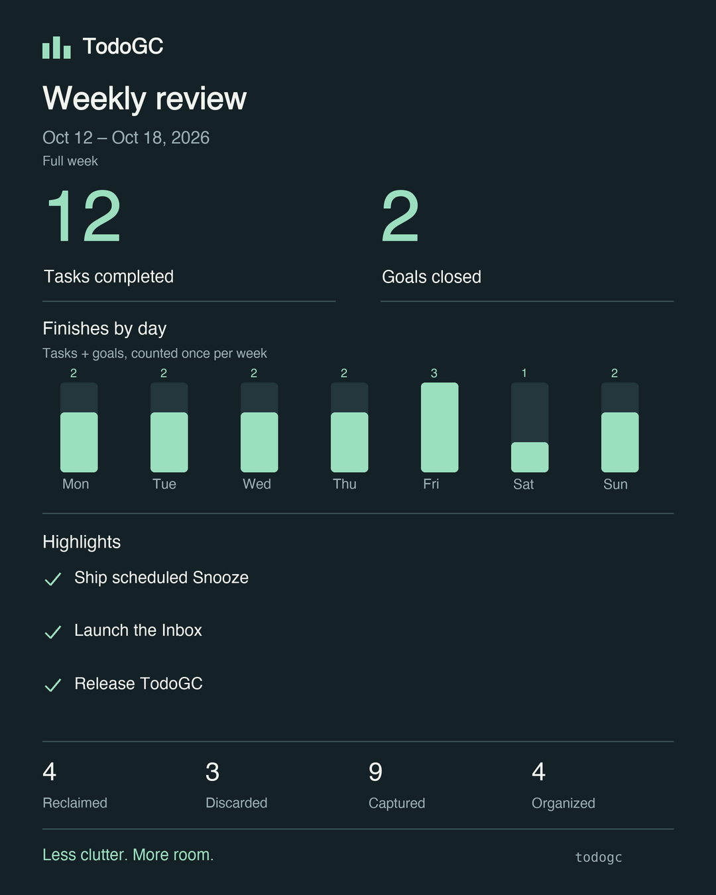

# TodoGC

一个本地任务管理工具：把未完成的工作视为内存堆，将任务关联到实际目标，安排今日行动，
再通过垃圾回收检查失去目的或长期停滞的任务。


[](https://github.com/Anderson-ops-oss/TodoGC/actions/workflows/ci.yml)


提供终端 CLI、可选本地网页、Inbox、多层子任务、Today、定时 Snooze、完成历史、周报分享卡，
以及可选 ntfy 提醒。数据保存在本地 SQLite 数据库中。
**英文是主要语言**；本页是可选中文文档，主文档见 [English README](README.md)。

## 安装与快速开始

需要 **Python 3.10+**。发布到 PyPI 后，无须克隆仓库即可安装：

```bash
python -m pip install todogc
```

如果已安装 [pipx](https://pipx.pypa.io/stable/installation/)，可用 `pipx install todogc`，
由它自动管理独立环境，不需要手动创建或激活。源码安装见[开发](#开发)。
核心仅使用 Python 标准库，扩展按需安装：

| 功能 | 从 PyPI 安装 |
|---|---|
| 终端彩色输出 | `python -m pip install "todogc[color]"` |
| 网页及 PNG 导出 | `python -m pip install "todogc[web]"` |
| 仅 PNG 导出 | `python -m pip install "todogc[export]"` |

升级使用 `python -m pip install --upgrade todogc`；通过 pipx 安装时用 `pipx upgrade todogc`。
首次用 pipx 安装时，需要网页可选择 `pipx install "todogc[web]"`。

创建目标及两层子任务：

```bash
todogc add "Release TodoGC" --root            # 新数据库中的 #1
todogc add "Write the user guide" --root-id 1 # #2
todogc add "Check the examples" --root-id 2   # #3
todogc focus 3
todogc today
todogc progress 3 "Checked the quick start"
todogc done 3 "Examples verified"
todogc tree --show-completed
```

请使用命令实际返回的编号。本文后续示例是单项操作示范，不是可以依次套用到现有数据库的脚本。
普通任务管理不需要配置文件或通知服务；英文输出也不需要语言参数。

## 使用指南

命令、示例和相关规则集中在本节：

| 我想…… | 对应章节 |
|---|---|
| 选择数据库、配置文件或语言 | [数据与配置](#数据与配置) |
| 新建、编辑、完成或重新打开任务 | [任务生命周期](#任务生命周期) |
| 整理目标和多层子任务 | [任务树与关联](#任务树与关联) |
| 先记下一个尚未确定的想法 | [Inbox](#inbox) |
| 安排今天做什么 | [Today](#today) |
| 查找和筛选任务 | [搜索与筛选](#搜索与筛选) |
| 暂停任务直到指定时间 | [Snooze 与 defer](#snooze-与-defer) |
| 诊断、回收或恢复任务 | [GC 与恢复](#gc-与恢复) |
| 查看完成统计、导出分享图 | [每周回顾](#每周回顾) |
| 配置提醒、管理后台进程 | [Watch 与通知](#watch-与通知) |
| 使用浏览器管理任务 | [网页端](#网页端) |

### 数据与配置

默认使用**当前目录的 `todogc.db` 和 `todogc.toml`**。数据库首次使用时创建，配置文件可选。
完整配置模板见 [todogc.toml.example](todogc.toml.example)。

全局选项放在**子命令前面**：

```bash
todogc --db /absolute/path/tasks.db today
todogc --config /absolute/path/todogc.toml --db /absolute/path/tasks.db watch status
todogc --heap-max 100 --gc-mode gentle gc --dry-run
```

切换目录或管理 Watch 时应指向同一数据库。`--config` 只选择配置文件，不选择数据库；
可在 shell 中设置 `TODOGC_DB` 和 `TODOGC_CONFIG`，让不同会话使用固定路径。

优先级为 **CLI 参数 > 环境变量 > 配置文件 > 默认值**。常用配置如下：

| TOML 配置项 | 默认值 | 环境变量 |
|---|---|---|
| `[heap] max` | `50` | `TODOGC_HEAP_MAX` |
| `[gc] mode` | `"normal"` | `TODOGC_GC_MODE` |
| `[gc] recent_days` | `30` | `TODOGC_RECENT_DAYS` |
| `[gc] max_consecutive_skips` | `5` | `TODOGC_MAX_SKIPS` |
| `[gc] restore_grace_days` | `7` | `TODOGC_RESTORE_GRACE_DAYS` |
| `[i18n] lang` | `"en"` | `TODOGC_LANG` |

需要中文时，可用 `--lang zh`、`TODOGC_LANG=zh` 或 `[i18n] lang = "zh"`。
网页的语言选择只作用于当前会话，初始值来自配置。Watch 推送使用配置或 `TODOGC_LANG` 中的
语言；网页选择器与 CLI `--lang` 不改变推送语言。帮助文本读取 `--lang` 和环境变量，
不会提前读取配置文件中的语言。部分可选中文诊断字段仍为英文；用户标题和备注不做翻译。

使用任务存储的命令会在打开数据库时自动迁移，并提前生成 `.bak`；Watch status 和 logs
不会创建或迁移数据库。数据库及本地通知凭据应保留在本地，不要提交到 Git。

### 任务生命周期

```bash
todogc add "Publish the guide" --root-id 1
todogc progress 2 "First draft ready"
todogc edit 2 "Publish the revised guide"
todogc edit 2 --ref weak
todogc show 2
todogc history 2 --limit 10
todogc done 2 "Published"
todogc completed
todogc reopen 2
todogc reopen 2 --root-id 1
```

| 命令 | 含义 |
|---|---|
| `add` | 创建任务，网页称为 **Allocate task**。 |
| `progress` | 记录一次实际推进及可选备注，不代表完成。 |
| `edit` | 修改标题或引用强度，也计入推进指标。 |
| `show` | 查看当前状态、父任务、分代及推进、浏览、推迟计数。 |
| `history` | 查看只追加、不覆盖的事件与备注。 |
| `done` | 标记成功完成，释放容量。 |
| `completed` | 列出已完成任务及完成时间。 |
| `reopen` | 重新打开已完成任务，保留历史。 |

已完成任务不在默认列表中，也不参加 GC 检查；需要先重新打开才能编辑、推进或 Snooze。
目标和元任务同样可以完成。成功完成进入 **Completed**，放弃或回收进入 **graveyard**。

父任务仍有未完成后代时，单独完成会被拒绝。可以先完成或移动后代，或明确一起完成整棵子树：

```bash
todogc done 1 --with-subtasks
```

该选项涵盖所有层级的未完成后代。完成最后一个子任务不会自动完成父任务。
重新打开只影响指定任务，保留 Root 身份和分代，并获得配置的恢复宽限期。
原父任务不可用时，先重新打开父任务，或通过 `--root-id` 指定其他活跃父任务。

容量上限默认是 50 个未完成的非元任务，包括 Inbox 和 Snooze。
`add`、`capture`、`reopen`、`restore` 支持 `--force` 明确超配，网页称为 **Force over-allocate**。
完成或回收任务会释放容量。

### 任务树与关联

```bash
todogc add "Ship the release" --root
todogc add "Prepare documentation" --root-id 1
todogc add "Proofread examples" --root-id 2
todogc tree
todogc tree --show-completed --show-snoozed
todogc link 3 1                      # 将 #3 移到 #1 下
todogc link 3 --off                  # 解除父任务关联
todogc root 2                       # 将 #2 标记为活跃目标
todogc root 2 --off                  # 取消目标身份
```

`--root` 声明一个活跃目标，即 **GC root**。`--root-id` 实际选择的是直接父任务，
因此子任务下面也可以继续添加子任务；系统拒绝父子循环。
两项都不指定也能创建任务，它会进入 **Unlinked**，但可能因无法从活跃目标到达而成为 GC 候选。
尚未决定归属的想法更适合使用 `capture`。

任务树仅使用父子关联，顶层按 Inbox、Goals、Unlinked、Meta-tasks 分组。
已完成和休眠任务默认隐藏；必要时保留隐藏父任务作为可见子任务的路径。浏览任务树不增加 view。

另有两种独立于树层级的高级用法：

```bash
todogc dep 2 3                      # 添加 #2 指向 #3 的理由/引用边
todogc dep 2 3 --remove
todogc add "Review how I plan work" --meta
```

`dep` 影响 GC 可达性和引用环检测，不会移动树节点、加入 Today 或强制执行顺序。
元任务位于 **Metaspace**，不占普通容量，也不参与普通 GC 回收。
引用强度与分代规则见 [GC 工作原理](#gc-工作原理)。

### Inbox

先捕获想法，稍后再决定是否投入：

```bash
todogc capture "Explore a browser extension"
todogc inbox
todogc inbox --move 7                # 明确移入已有的独立未关联任务
```

使用实际编号，选择以下一种处理方式：

```bash
todogc link 7 1                      # 归入父任务，移出 Inbox
todogc root 7                        # 转为目标，移出 Inbox
todogc done 7                        # 直接完成
todogc discard 7 "Not pursuing it"   # 放弃，进入墓园
```

待整理想法占容量，但不参加 GC 和泄漏诊断。停留满 7 天显示 **Needs review**，不会自动删除。
需要先整理才能作为父任务或加入 Today。普通 Unlinked 任务不会自动进入 Inbox。

放弃后使用 `restore`、完成后使用 `reopen`，都会返回原 Inbox，保留历史并重置待整理计时；
明确指定 `--root-id` 则转为该父任务下的普通任务。捕获、查看及整理不增加 view 或推进次数。

### Today

```bash
todogc focus 2                              # 追加单个任务
todogc focus 1 --with-subtasks              # 包括各层可执行后代
todogc focus 4 --position 1                 # 放到第一位，可用于重排
todogc focus 1 --with-subtasks --position 1  # 整组移动
todogc today
todogc unfocus 4                            # 移除计划项或忽略建议
```

Today 按本机**本地日期**保存有序计划，终端与网页共享，重启后保留。
目标和子任务均可选择；Inbox 需要先整理，休眠任务需要先唤醒。

`focus ID` 只选择指定任务。`--with-subtasks` 遍历所有层级的父子关联，跳过已完成、已回收、
Inbox 和仍休眠的后代；休眠父任务下未休眠的子任务仍可加入。起始任务本身必须可执行。
不跟随理由边。新选择按父任务在前的顺序追加，已选择项保持原位且不重复；
加 `--position N` 会把可执行分支作为整体移动到剩余选择中的指定位置。

跨过午夜后开始新计划，之前未完成的选择和今天 Snooze 到期的任务只作为**建议**，
需要显式 `focus` 才进入计划。`unfocus` 可忽略建议，直到重新选择。
已完成或变得不可执行的计划项仍会在当天保留；**Completed today** 也包含计划外完成项。

安排计划不增加浏览、推进、推迟或分代年龄，也不提供 GC 保护。实际工作用 `progress`、`done` 记录。

### 搜索与筛选

```bash
todogc ls
todogc ls -q "write" --root-id 1 --sort newest --limit 10
todogc ls --scope inbox
todogc ls --scope snoozed
todogc ls --state done
todogc ls --state candidate
todogc search "release"
todogc search "feedback" --notes --scope active
todogc search "guide" --scope done --sort title
```

`ls` 默认列出 Inbox 以外、未休眠的未完成任务；`search` 默认覆盖**所有状态**，包含已完成和已回收。
共享选项如下：

| 选项 | 含义 |
|---|---|
| `-q TEXT` / `--search TEXT` | `ls` 的标题关键词；`search` 直接接关键词参数。 |
| `--notes` | 同时匹配历史备注。 |
| `--root-id ID` | 指定任务自身及所有层级的父子后代。 |
| `--scope` | `active`、`inbox`、`snoozed`、`done`、`collected`、`all`。 |
| `--state` | 与 scope 二选一：`live`、`candidate`、`done`、`collected`；candidate 动态计算当前 GC 候选。 |
| `--sort` | `id`（默认）、`newest`、`oldest`、`title`、`updated`；updated 忽略浏览事件。 |
| `--limit N` | 筛选、排序之后限制条数。 |

关键词为不区分大小写的字面子串，`%`、`_`、引号不是通配符。
active 排除 Inbox 和休眠任务；inbox 只含未休眠的待整理想法，休眠想法用 snoozed 查找。

`search` 只读。普通 `ls` 只为实际显示的结果增加 view，默认列表不会给已完成任务增加 view。
动态候选列表、`show`、`history`、`tree`、`today` 和网页浏览不增加 view。
浏览不计入推进，也不能让任务保持存活。

### Snooze 与 defer

```bash
todogc snooze 4 --for 2h
todogc snooze 4 --for 3d --note "Waiting for feedback"
todogc snooze 4 --until "2030-10-25 09:00"
todogc snooze 1 --for 1w --with-subtasks
todogc snoozed
todogc unsnooze 4
todogc unsnooze 1 --with-subtasks
todogc defer 4 "Postponed without a return date"
```

Snooze 隐藏任务至未来时间，保留父子关联、Root 身份、分代和容量占用，期间受 GC 与泄漏检查保护。
不增加 skip 或 progress。`--with-subtasks` 同时休眠未完成后代，否则子任务保留自己的安排。

时长支持 `m/h/d/w`，`1d` 为 24 小时。日期默认本地时区，也可用
`2030-10-25T09:00+09:00` 明确偏移，数据库存 UTC。请把示例日期替换为未来时间。
再次 `snooze` 改期，`unsnooze` 提前唤醒。

到期后，下次命令或网页刷新会重新显示任务，不依赖后台进程。
唤醒提供固定 7 天 GC 宽限期，从预定时间计算；提前唤醒则从操作时刻计算。完成或放弃会取消计划。
主动推送到期提醒需要配置 [Watch](#watch-与通知)。

`defer` 仅记录一次推迟，不隐藏任务、不安排返回时间；多次推迟可能让任务成为 GC 候选。
真正做了工作应使用 `progress`。

### GC 与恢复

| 命令 | 用途 | 是否改变任务状态 |
|---|---|---|
| `heap` / `jmap` | 查看分代布局、容量和候选标记。 | 否 |
| `doctor` | 诊断认知泄漏，也审计常驻目标和元任务。 | 否 |
| `gc --dry-run` | 查看 GC 报告和拟回收列表。 | 否 |
| `gc` | 查看同样的报告，再逐个决定如何处理。 | 取决于选择 |
| `stats --since 30d` | 查看最近 30 天记录的 GC 次数和结果。 | 否 |

```bash
todogc heap
todogc doctor
todogc gc --dry-run
todogc gc --mode gentle
todogc stats --since 30d
todogc graveyard
todogc restore 4 --root-id 1
```

回收仪式提供 **revive / collect / skip**。revive 保留候选并增加分代年龄；collect 回收到墓园并可留备注；
skip 暂不解决。实际 GC 写入审计记录，dry-run 不写。Watch 只检查和提醒，不会替你执行回收仪式。

`graveyard` 列出回收或放弃的任务与备注。`restore 4 --root-id 1` 将墓园中的 #4 恢复到活跃父任务 #1 下，
保留历史并获得配置的宽限期。已完成工作用 `reopen`。
`gc --full` 只改变报告的 pause 标签，使用相同回收规则。

### 每周回顾

`review` 统计完成与清理成果，`stats` 统计 GC 审计历史。

```bash
todogc review                               # 本周截至现在
todogc review --week last
todogc review --week 2026-10-19 --timezone Asia/Tokyo
todogc review --week last --export weekly.svg
todogc review --week last --export weekly.png
todogc review --week last --highlight 2 --highlight 5 --export weekly.png --save
todogc review --list
todogc review --snapshot 1 --export saved-week.svg
todogc review --snapshot 1 --export saved-week.json
```

SVG 无额外依赖，PNG 需 `[export]` 或 `[web]`。图片均在本地生成，尺寸为 1080 × 1350。
分享卡使用英文，默认只有数字；`--highlight` 最多添加三个完成项标题，编号以回顾实际列出的为准。
JSON 包含完整回顾及所有完成项标题。



*使用示例数据生成的分享卡。*

一周从周一零点至下周一零点，不含结束时刻。默认本地时区，`--timezone` 可指定 IANA 时区。
本周只统计生成时刻之前，标记 **In progress**；不接受未来周。

- 每个任务每周只算一次，归入本周首次完成当天；重新打开单列，不抹去完成。目标与其他任务分别统计。
- 整棵子树完成时，目标和各个完成后代分别计数；元任务和直接完成的想法算非目标任务。
- 捕获、整理、Inbox 放弃和实际 GC 回收分别在周期内按任务编号去重；预演不算回收。
- **Task load now** 记录生成时刻的活跃、休眠及待整理 Inbox 数量，即使查看的是历史周。

`--save` 将数字、标题、亮点、时区边界和当时任务量固定为数据库快照，使用 `--list`、`--snapshot ID` 查看。
新事件保留发生时的任务标签；缺少标签的旧事件使用当前元数据并在回顾中注明，保存后固定解析结果。
查看和导出不增加 view、progress 或 GC 次数。

### Watch 与通知

Watch 默认每 **60 秒**检查一次，通过 ntfy 推送。
**`watch`、`watch start`、`watch test` 都需要先配置通知**；普通任务管理和 Snooze 到期显示不需要。

**1. 在工作目录创建 `todogc.toml`（若尚不存在）。**
可直接使用以下内容，或下载前文链接的完整模板；pip/pipx 用户不需要克隆仓库。

**2. 添加或替换 `[notify]` 和 `[watch]` 段：**

```toml
[notify]
ntfy_enabled = true
ntfy_server = "https://ntfy.sh"
ntfy_topic = "replace-with-your-own-hard-to-guess-topic"
# ntfy_token = "..."             # 受保护 topic 使用，建议通过 TODOGC_NTFY_TOKEN 设置

[watch]
poll_seconds = 60
digest_seconds = 86400
remind_days = 7
heap_threshold_pct = 80
lock_stale_seconds = 300
weekly_review_enabled = true
weekly_review_day = "friday"
weekly_review_time = "17:00"
weekly_review_timezone = "local" # 也可指定 Asia/Tokyo 等 IANA 时区
```

接收端需订阅同一 ntfy 服务器上的同一 topic。只复制模板还不够：模板默认关闭推送，topic 也为空。
不要提交 token，环境变量 `TODOGC_NTFY_TOKEN` 会覆盖文件中的值。

**3. 先测试，再启动后台检查：**

```bash
todogc watch test
todogc watch start
todogc watch status
todogc add "Plan next week" --root  # 同一终端仍可继续使用
todogc watch logs --lines 50
todogc watch stop
```

| 命令 | 含义 |
|---|---|
| `watch` | 前台运行，Ctrl-C 停止。 |
| `watch start` | 后台运行；同一数据库已有实例时显示现有实例。 |
| `watch status` | 查看运行模式、PID、心跳、检查时间、通知结果和周报安排；`--json` 用于脚本。 |
| `watch test` | 仅发一条通用通知，不检查任务、不确认 Snooze、不生成周报。 |
| `watch logs --lines N` | 查看最近日志，包含轮转文件。 |
| `watch stop` | 请求正常停止；发送中的通知可能先完成。 |

测试成功表示服务器已接收，还需要确认接收端实际收到。
出现 **Scheduled push not enabled** 时，检查当前目录、`--config` / `TODOGC_CONFIG`、
`ntfy_enabled = true` 和非空 `ntfy_topic`。发送失败可查看 status、logs，并核对服务器、topic 及所需 token。

实际推送内容包括：

- Snooze 到期提醒，同次检查合并，失败下次重试。
- 新增或变化的 GC 候选，以及相同状态持续 `remind_days` 后的提醒。
- 容量新跨过 `heap_threshold_pct` 时的告警。
- 每隔 `digest_seconds` 的心跳摘要，即使没有新事件。
- 配置时刻的每周回顾，默认**每周五 17:00**。

每分钟检查不等于每分钟推送。周报通知包含数字与快照编号，不附图片或任务标题；打开快照后再选择亮点并导出。
定时回顾只包含所在周严格早于预定截止时刻的事件，周五晚些时候和周末不补入；当前任务量取实际生成时刻。

启动时（包括首次启动）会补发最近一期已到期但未成功送达的回顾；错过多周也只补最近一期。
失败重试同一快照，成功状态跨重启保留。`weekly_review_enabled = false` 关闭周报推送。
环境变量使用 `TODOGC_WATCH_WEEKLY_REVIEW_` 前缀与 `ENABLED`、`DAY`、`TIME`、`TIMEZONE` 后缀。

前台、后台和网页 watcher 对同一数据库共用一个运行实例。停止网页 watcher 只停止检查线程，
网页继续可用；通过 `watch start` 或重启网页恢复。后台使用启动时的有效配置，修改后先 stop 再 start。
status 会标明展示的是运行中、上次运行或当前配置。

日志位于数据库旁的 `<database>.watch/watch.log`，单文件最多 1 MiB，保留三个备份。
状态与日志不保留 ntfy 凭据；配置损坏时 status、logs、stop 仍可使用。
关闭终端后后台仍可运行，但电脑需保持唤醒；休眠期间不检查。
**电脑重启后需要重新 start，目前不包含登录自启。**

### 网页端

安装 `[web]` 后执行：

```bash
todogc web
todogc web --port 8502
```

网页与终端共享数据库和核心规则，侧栏按使用场景组织：

| 页面 | 功能 |
|---|---|
| **Today**（默认） | 安排今日顺序、查看建议、记录推进与完成。 |
| **Tasks** | 任务树、搜索筛选、创建、详情、移动及已完成管理。 |
| **Inbox** | 捕获、整理、休眠、完成、放弃和恢复想法。 |
| **Weekly review** | 选择周与时区、预览分享卡、选择亮点、下载与保存快照。 |
| **Maintenance** | 堆图、GC 回收仪式、泄漏诊断、GC 历史与墓园恢复。 |

表单中的 **Allocate task** 表示创建；**Active root** 声明目标；**Meta-task** 使用 Metaspace；
**Reference strength** 选择保留规则；**Force over-allocate** 允许超出容量。
**Mark as done** 标记完成，包含未完成子任务需要明确勾选。详情也提供推进、编辑、Snooze、关联与历史。

展开树和页面刷新不增加 view，同一会话切换页面会保留搜索条件。
启用通知后，网页会启动同样的检查线程，并与终端 watcher 共享实例所有权。
未安装可选依赖时，`todogc web` 会提示安装方式。

## GC 工作原理

GC 找出**需要你审阅的候选**。Root 是活跃目标，普通任务需要能从目标经父子关联或引用边到达。
Inbox、休眠任务、近期恢复/重新打开/复活和刚唤醒的任务另有保护规则，见使用指南。
Root 和元任务默认常驻，由 `doctor` 单独审计。

对宽限期以外、可达的普通任务：

| 引用强度 | 保留条件 |
|---|---|
| `strong` | 可达即可。 |
| `soft`（默认） | 近期有有效活动或推进，且连续推迟次数低于阈值。 |
| `weak` | 近期有推进/编辑，且连续推迟次数低于阈值。 |

浏览和推迟不刷新有效活动时间。默认配置对应：

| 模式 | 活动窗口 | 连续推迟阈值 |
|---|---|---|
| `gentle` | 60 天 | 7 |
| `normal` | 30 天 | 5 |
| `aggressive` | 15 天 | 3 |

模式基于配置值调整：gentle 窗口乘二、阈值加二；aggressive 窗口减半、阈值减二，最低均为一。
达到阈值即不满足活动检查。strong 仍需可达；完全脱离目标的引用环可能成为循环引用候选。
推进、编辑、复活和恢复会重置连续推迟，保留累计历史。

分代表示一个候选被明确保留过多少次：

| 区域 | 进入条件 |
|---|---|
| **Eden** | 新任务，年龄为 0。 |
| **Survivor** | 在 GC 仪式中复活 1–14 次。 |
| **Old** | 复活至少 15 次。 |
| **Metaspace** | 显式元任务，不属于普通晋升序列。 |

年龄只在仪式中选择复活时增加，不随时间或每次检查增加。
完成/回收后退出活跃堆，重新打开保留分代。

## 开发

开发或源码安装时，在项目目录运行：

```bash
python3 -m venv .venv
source .venv/bin/activate
python -m pip install -e ".[dev]"
ruff check todogc tests scripts
basedpyright
pytest
python -m build
python -m twine check --strict dist/*
```

上述激活命令适用于 macOS/Linux；Windows PowerShell 使用 `.venv\Scripts\Activate.ps1`。
可编辑安装扩展使用 `python -m pip install -e ".[web]"` 或其他对应 extra。

wheel 与源码包输出到 `dist/`。核心无运行时依赖；rich、Streamlit、Pillow 均为可选扩展。
使用 `python scripts/smoke_wheel.py /path/to/todogc.whl` 可将指定 wheel 安装到临时独立环境，
离开源码目录验证命令是否可用。

### 发布

[publish.yml](.github/workflows/publish.yml) 使用 PyPI Trusted Publishing，登记值如下：

| PyPI 字段 | 内容 |
|---|---|
| Project | `todogc` |
| Owner | `Anderson-ops-oss` |
| Repository | `TodoGC` |
| Workflow | `publish.yml` |
| Environment | 留空，工作流不声明 environment。 |

无需保存 PyPI API token。GitHub Actions 中的 **Publish to PyPI → Run workflow** 仅做测试、
构建、元数据检查和独立安装验证，不上传；普通 push 也不会发布。

正式发布时，确保 `pyproject.toml` 与 `todogc.__version__` 一致，将更改提交到 `main`，
再发布标签为 `v<version>` 的非预发布 GitHub Release。工作流检查版本和标签是否位于 main 历史，
运行 Python 3.10–3.13 测试，构建、检查包并通过 OIDC 上传验证过的产物。
只有上传任务能申请身份令牌。以后每次发布都需要新的版本号，PyPI 文件无法覆盖。

| 模块 | 职责 |
|---|---|
| `heap.py`、`store.py` | 模型、SQLite、事件历史与迁移。 |
| `collector.py`、`report.py` | 可达性、引用环、GC 策略与诊断。 |
| `tree.py`、`query.py`、`today.py` | 共享任务树、搜索与每日计划。 |
| `review.py`、`review_card.py` | 周统计、快照与导出。 |
| `notify.py`、`watcher.py`、`watch_service.py`、`scheduling.py` | 推送、检查、进程管理与调度。 |
| `config.py`、`i18n.py`、`locales/` | 配置与英中文案。 |
| `cli.py`、`webapp.py` | 终端与可选网页界面。 |

## License

MIT
